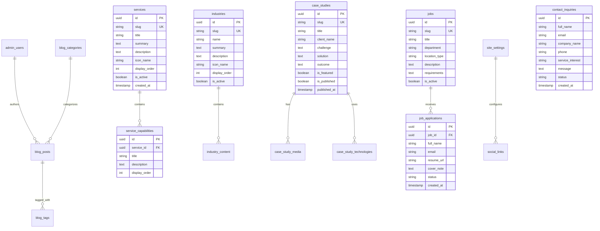

# TechSphere Technology — Technical Architecture Specification

## 1. System Architecture Overview

The TechSphere Technology web platform is built on a modern, high-performance architecture utilizing **Next.js 16 (App Router)**, **React 19**, **TypeScript**, **Tailwind CSS v4**, **GSAP**, **Three.js / React Three Fiber**, and **Supabase (PostgreSQL)**.

The platform enforces a strict separation between:
1. **Public Marketing & Capabilities Surface:** Statically generated and ISR-cached pages with client-side progressive enhancement (3D & GSAP motion).
2. **Interactive & Intake Systems:** Type-safe form actions for consultation requests and career applications.
3. **Protected Admin / CMS Platform:** Role-based authenticated dashboard for content management and telemetry.

```
┌─────────────────────────────────────────────────────────────┐
│                    Next.js 16 App Router                    │
├──────────────────────────────┬──────────────────────────────┤
│       Public Surface         │     Protected Admin CMS      │
│  (RSC, ISR, Static Assets)   │  (SSR, Supabase Auth, RBAC)  │
├──────────────────────────────┴──────────────────────────────┤
│                     Component Layer                         │
│  ┌────────────┬─────────────┬─────────────┬──────────────┐  │
│  │ ui/ (Base) │ layout/     │ sections/   │ three/ (R3F) │  │
│  └────────────┴─────────────┴─────────────┴──────────────┘  │
├─────────────────────────────────────────────────────────────┤
│                    Application Core                         │
│   lib/ (Supabase, Utils)  │  hooks/  │  types/ (Zod/DB)     │
├─────────────────────────────────────────────────────────────┤
│                 Backend & Persistence                       │
│        Supabase (PostgreSQL, Storage, Auth, RLS)            │
└─────────────────────────────────────────────────────────────┘
```

---

## 2. Directory & Folder Architecture

```
techsphere/
├── app/                              # Next.js App Router root
│   ├── (public)/                     # Public marketing routes
│   │   ├── page.tsx                  # Homepage
│   │   ├── services/                 # Services catalog & [slug]
│   │   ├── industries/               # Industries catalog & [slug]
│   │   ├── work/                     # Case studies & [slug]
│   │   ├── company/                  # About, Values, Growth Vision
│   │   ├── insights/                 # Blog articles & [slug]
│   │   ├── careers/                  # Job listings & [slug]
│   │   ├── contact/                  # Consultation intake
│   │   ├── privacy/                  # Privacy policy
│   │   └── terms/                    # Terms of service
│   ├── admin/                        # Protected CMS routes
│   │   ├── layout.tsx                # Admin sidebar & auth guard
│   │   ├── page.tsx                  # Admin login
│   │   ├── dashboard/                # Analytics & metrics
│   │   ├── inquiries/                # Contact form submissions
│   │   ├── applications/             # Job applications
│   │   ├── services/                 # Service & capability editor
│   │   ├── industries/               # Industry content editor
│   │   ├── case-studies/             # Case study management
│   │   ├── blog/                     # Blog post editor
│   │   ├── careers/                  # Job requisition editor
│   │   ├── team/                     # Team member editor
│   │   ├── testimonials/             # Testimonial verification
│   │   ├── media/                    # Media asset manager
│   │   └── settings/                 # Site settings & social links
│   ├── api/                          # Route handlers & webhooks
│   ├── globals.css                   # Tailwind CSS v4 & theme tokens
│   └── layout.tsx                    # Root layout & font definitions
├── components/                       # Modular UI components
│   ├── ui/                           # Base UI & shadcn primitives (button, input, etc.)
│   ├── layout/                       # Header, Footer, Navigation, Container
│   ├── sections/                     # Homepage & page-specific narrative sections
│   ├── motion/                       # GSAP wrappers, reveals, and transition wrappers
│   └── three/                        # R3F Canvas, DottedSphere, Shaders, Fallbacks
├── lib/                              # Core utilities & singleton clients
│   ├── supabase/                     # Supabase client, server, and middleware helpers
│   ├── validators/                   # Zod schemas for forms & database entities
│   └── utils.ts                      # Classname merging and formatting helpers
├── hooks/                            # Custom React hooks
│   ├── use-media-query.ts            # Responsive breakpoint detection
│   ├── use-prefers-reduced-motion.ts # Accessibility motion detection
│   └── use-scroll-progress.ts        # Normalized scroll telemetry
├── types/                            # TypeScript type definitions
│   ├── database.types.ts             # Supabase generated database schema types
│   ├── content.types.ts              # Domain content models
│   └── navigation.types.ts           # Route & menu definitions
├── public/                           # Static assets (favicons, SVGs, brand marks)
└── docs/                             # Project specifications & architecture records
```

---

## 3. Database Architecture & Schema (Supabase / PostgreSQL)

### 3.1 Entity Relationship Model



### 3.2 Security & Row Level Security (RLS) Policies
1. **Public Read-Only Access:** All published `services`, `industries`, `case_studies`, `blog_posts`, and `jobs` have `SELECT` permitted to `anon` role where `is_published = true` or `is_active = true`.
2. **Public Insert-Only Access:** Unauthenticated visitors can execute `INSERT` into `contact_inquiries` and `job_applications` with strict rate-limiting and honeypot validation.
3. **Admin Full Access:** All mutation (`INSERT`, `UPDATE`, `DELETE`) and read access to unpublished records, inquiries, and applications is restricted to authenticated users verified via Supabase Auth with valid administrative claims in `admin_users`.

---

## 4. 3D & Motion Subsystem Architecture

### 4.1 React Three Fiber Integration Strategy
* **Client Boundary:** All 3D components reside in `components/three/` with `'use client'`.
* **Dynamic Import:**
  ```typescript
  // components/three/techsphere-canvas.tsx
  import dynamic from "next/dynamic";

  export const TechSphereCanvas = dynamic(
    () => import("./scene").then((mod) => mod.TechSphereScene),
    {
      ssr: false,
      loading: () => <TechSphereCanvasFallback />,
    }
  );
  ```
* **Performance Control:** 
  * Frame loop is throttled when offscreen using `@react-three/drei`'s `<AdaptiveDpr>` and intersection listeners.
  * Number of particles scales based on device pixel ratio and screen width.

### 4.2 GSAP Subsystem
* Animations are scoped via `@gsap/react` using the `useGSAP` hook.
* ScrollTrigger instances are registered once in a global provider or layout client wrapper.
* Smooth scroll is managed with native CSS scroll behavior or lightweight Lenis, ensuring accessibility and touch gesture integrity.

---

## 5. Form Handling & Data Validation

* **Validation Engine:** `Zod` schemas define contracts for both client and server actions.
* **Forms:** `react-hook-form` with `@hookform/resolvers/zod`.
* **Server Actions:** Next.js Server Actions process incoming form submissions, execute server-side Zod validation, sanitize inputs, and write directly to Supabase with the service role key.

---

## 6. SEO, Performance & Security Standards

1. **SEO:**
   * Dynamic Open Graph images generated via `@vercel/og` or optimized static cards.
   * JSON-LD structured data (`Organization`, `Service`, `JobPosting`).
   * Canonical URL configuration and dynamic `sitemap.ts` and `robots.ts`.
2. **Performance:**
   * Route prefetching for high-probability paths.
   * `next/image` for all raster assets with explicit WebP/AVIF formatting and responsive `sizes`.
   * Minimal third-party font overhead using `next/font/google`.
3. **Security:**
   * Content Security Policy (CSP) headers protecting against script injection.
   * Strict CORS on API handlers.
   * Secure, HTTP-only cookies for admin session tokens.
